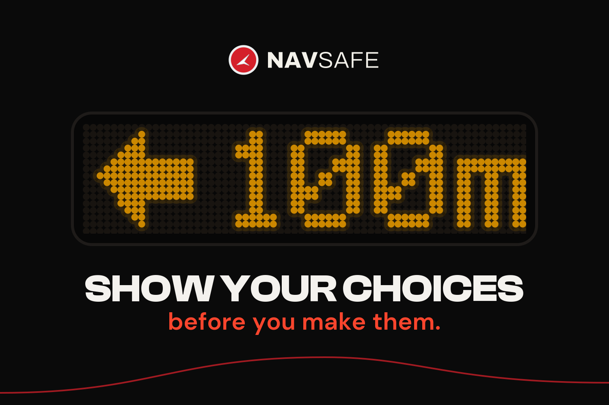
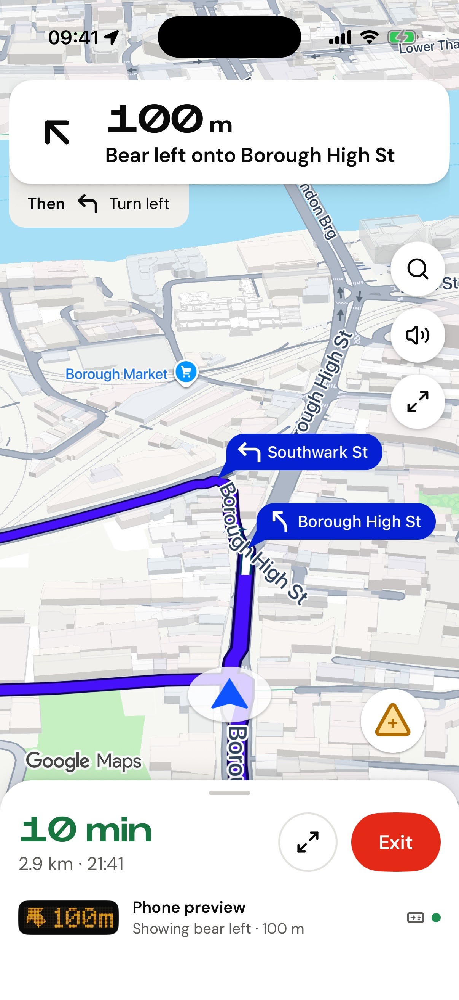
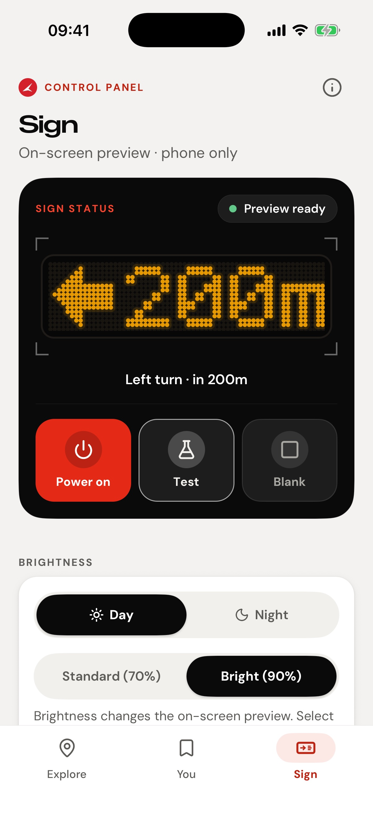
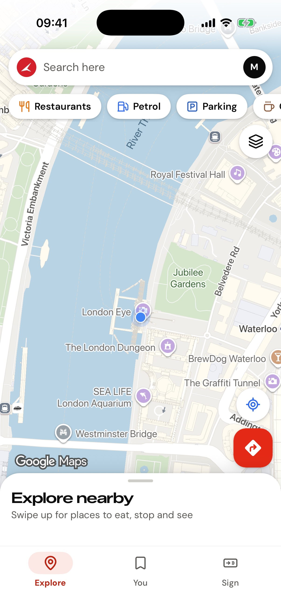
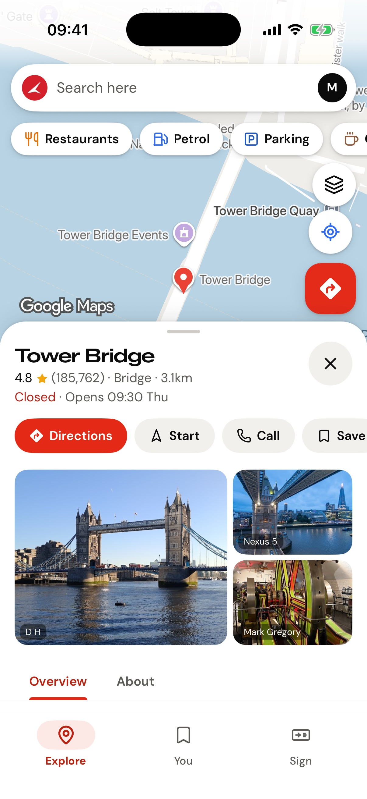
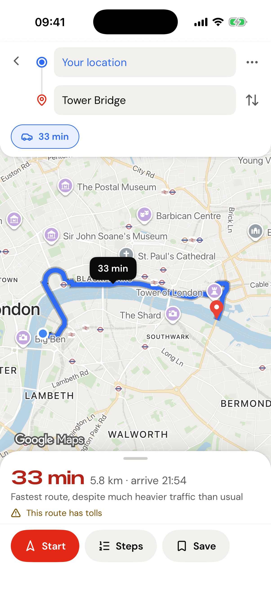

# NavSafe for SideStore

Early-access iPhone builds of [NavSafe](https://navsafe.uk), turn-by-turn
navigation that shows the drivers behind you your next turn on a rear-window
sign. This source carries NavSafe while the App Store version is in review.

**Source URL**

```
https://raw.githubusercontent.com/maxtheobaldd/navsafe-altstore/main/source.json
```

<p>
  
  
  
  
  
</p>

## What you need

- An iPhone on **iOS 16 or later**, with a passcode set
- A Mac, Windows PC or Linux computer for the first setup only, and a USB cable
- Wi-Fi on the iPhone (SideStore can't install or refresh over mobile data)
- An Apple ID (a free one works)

## Install

### 1. Put SideStore on your iPhone (one-time)

Follow SideStore's official guide. It takes about ten minutes:

- [Prerequisites](https://docs.sidestore.io/docs/installation/prerequisites):
  install **LocalDevVPN** from the
  [App Store](https://apps.apple.com/app/localdevvpn/id6755608044) and
  **iloader** on your computer from [iloader.app](https://iloader.app)
  (on Windows, install iTunes first)
- [Install](https://docs.sidestore.io/docs/installation/install): connect the
  iPhone by USB, open iloader, sign in with your Apple ID, select your iPhone
  and choose **Install SideStore (Stable)**

Then on the iPhone:

1. **Settings → General → VPN & Device Management**: trust your Apple ID.
2. **Settings → Privacy & Security → Developer Mode**: turn it on and restart.
3. Open **LocalDevVPN** and tap **Connect**.
4. Open **SideStore** and sign in with the same Apple ID you used in iloader.
5. In **My Apps**, tap the **7 DAYS** counter next to SideStore to refresh it
   once. If it asks about a signing certificate, tap **Yes** or **Refresh Now**.

After this you don't need the computer again.

### 2. Add the NavSafe source

1. Open **SideStore** on the iPhone and go to the **Sources** tab.
2. Tap **+**, paste the source URL above and tap **Add**.

Or paste this into Safari on the iPhone and open it in SideStore:

```
sidestore://source?url=https://raw.githubusercontent.com/maxtheobaldd/navsafe-altstore/main/source.json
```

### 3. Install NavSafe

1. Make sure **LocalDevVPN** is connected.
2. Open **NavSafe** from the source (or the **Browse** tab) and tap **Free**.
3. Wait for SideStore to sign and install it, then open NavSafe from the home
   screen.
4. Allow location access. Choose **Always** if you want the sign to keep
   working with the screen off.

## Keeping NavSafe working

- **Refresh every 7 days.** Apps installed with a free Apple ID expire after
  seven days. Connect **LocalDevVPN**, then open SideStore → **My Apps** and
  tap **Refresh All**, which refreshes SideStore as well. A paid Apple
  Developer account extends this to a year.
- **LocalDevVPN must be connected** whenever SideStore installs, updates or
  refreshes an app. You can disconnect it afterwards.
- **Updates** appear in SideStore → **My Apps** when a new build is published
  here.
- A free Apple ID can have **three** sideloaded apps at once, and SideStore
  counts as one of them. It can also register only **ten App IDs a week**:
  NavSafe uses two, one for the app and one for its widgets and Live Activity.
  If SideStore offers to remove app extensions, removing them also removes the
  widgets and the Live Activity.

## What's different from the App Store version

- **CarPlay** and **Sign in with Apple** aren't available in sideloaded builds.
  Sign in with your email address instead.
- SideStore installs the app under your own Apple ID, so it sits alongside the
  App Store version rather than replacing it. When NavSafe reaches the App
  Store, install that version and delete this one. Anything saved to your
  NavSafe account comes with you when you sign in.

## Moving from AltStore

The source URL hasn't changed. Set up SideStore as above, add the source URL
in SideStore and install NavSafe from there. Then delete AltStore, and any
leftover AltStore copy of NavSafe, so they don't count against your three apps.
Anything saved to your NavSafe account comes back when you sign in.

## Something not working?

- Installation and refresh problems: see SideStore's
  [common issues](https://docs.sidestore.io/docs/troubleshooting/common-issues)
  and [FAQ](https://docs.sidestore.io/docs/faq). If SideStore stops refreshing
  after an iOS update or a reset, replace your
  [pairing file](https://docs.sidestore.io/docs/advanced/pairing-file).
- App problems: [NavSafe support](https://navsafe.uk/support).
